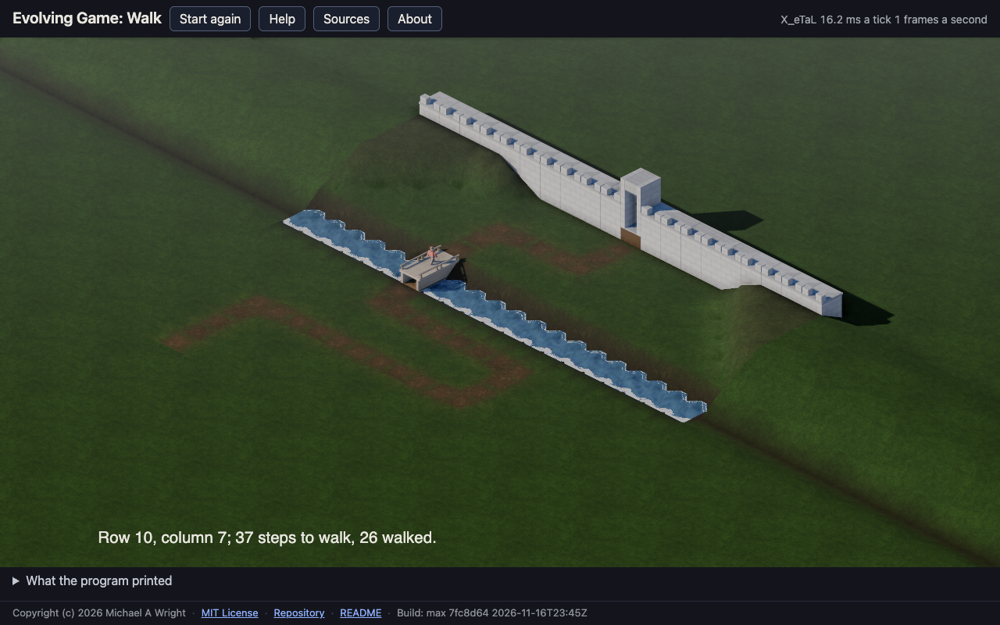

# Evolving Game

(A working title.)

[](https://sw-fun.github.io/evolving-game/)

Play it in a browser: the
[live demo](https://sw-fun.github.io/evolving-game/) (the picture
above is a link to it).

Evolving Game is a family of small castle-siege games that share one
world and grow into one larger game: what would a tower defense, a
logic puzzle, a tactics game and an explorer look like if they were
all the same castle, written in an array language, where every tower
against every creep is one table?

It is written in
[X_eTaL](https://github.com/softwarewrighter/X_eTaL), the
eXperimental Extensible Typed Array Language, and meant to be played
in a browser: X_eTaL compiled to WebAssembly, the castle drawn in 3D
by a Three.js player through
[X_eTaL-extensions](https://github.com/softwarewrighter/X_eTaL-extensions).
The rules, the world, the pictures and even the descriptions of the
3D models are X_eTaL; nothing about the game is computed in another
language.

Each game is small and playable by itself. Each is also a level or a
mini-game of one campaign, with a world map, levels and quests, in
which what you do in one game changes the castle the others are
played in: a puzzle solved in the keep powers the towers a defense
level starts with; a wall lost in a siege is a ruin to explore later.

## The games

| Game | Kind | What is distinctive |
| ---- | ---- | ------------------- |
| Castle Defense | tower defense, resources | enemies can destroy walls, opening new invasion routes |
| Rune Keep | logic puzzle | rune networks work like logic circuits: gates, state, timing |
| Dragonfire Tactics | turn-based squad tactics | fire spreads, ice blocks, lightning chains, wind bends shots |
| Siege Automata | programmable defenses | you program the towers: by hand, by rules, or in X_eTaL |
| Siege Engineer | physics puzzle | topple a tower or break a wall's support with limited shots |
| The Shattered Kingdom | exploration | the same castle before, during and after the siege |
| Siege Commander | real-time strategy | attack or defend across several elevations |
| An idler (not named yet) | idle game | the castle earns while you play something else, or nothing |

The first to be built is Castle Defense, starting with one level,
Defend the Bridge: one map, one road, three towers, three enemies,
five waves.

## Status

Early. There is one small game to play, in the
[live demo](https://sw-fun.github.io/evolving-game/), at the terminal
and in a browser of your own (a walk to the castle gate, below): the
walker follows the road by itself, the space bar stops and starts it,
and a click on a tile makes the game say what the tile is; otherwise the repository holds the plan,
the process, the tooling (the pinned X_eTaL, the tests, the gate) and
the first shared libraries (seeded chance, the event loop every game
runs in, and the world: the battlefield's map with its road found
from the gate).
[`docs/plan.md`](docs/plan.md) has the goal, the decisions made so
far, the questions still open, and the roadmap.

## How it is made

- **Rules in X_eTaL.** A game is one rules library and its data
  (TOML): entities are rows of a matrix, components its columns, and
  a rule is one expression over all of them.
- **One world.** The castle is five zones (battlefield, outer walls,
  courtyard, inner keep, cliffs and tunnels) kept as arrays: a grid
  of tiles with heights, with larger terrain worked out from a seed.
- **Assets from X_eTaL.** Each tower, creature and tile is described
  in X_eTaL as parts and named clips (idle, walk, fire, hit); the
  program drives [Blender](https://www.blender.org) in batch and gets
  back a 3D model a piece, as the
  [tower defense pieces](https://softwarewrighter.github.io/X_eTaL-extensions/blender/td/)
  of X_eTaL-extensions were made.
- **Drawn twice from one state.** A flat picture (SVG) and a 3D
  scene, both written by the game; the page's player draws the scene
  and decides nothing, as in the
  [live procedural city](https://softwarewrighter.github.io/X_eTaL-extensions/three/live/).
- **Repeatable.** The same level, seed and events always give the
  same game, so a list of events is a replay, a test and a save.

## Prerequisites

- [Rust](https://rustup.rs) (stable, via rustup) and
  [`just`](https://github.com/casey/just) (`brew install just` or
  `cargo install just`): to build the pinned X_eTaL the games run on.
- For the browser: the WebAssembly target and
  [trunk](https://trunkrs.dev):
  `rustup target add wasm32-unknown-unknown`, then `brew install trunk`
  or `cargo install trunk`.
- For the scripts: [uv](https://docs.astral.sh/uv/) (the Python
  environment is made with `uv venv`).
- To make the 3D models (optional; not needed to play or to test):
  [Blender](https://www.blender.org) 5.1.
- For the browser test: Google Chrome and [Node.js](https://nodejs.org) 22 or newer.
- For the pre-commit gate (maintainers): `sw-checklist` and
  `sw-markdown-checker`.

## Quick Start

With [`just`](https://github.com/casey/just) installed (`just` alone
lists the tasks):

```bash
just venv                            # the scripts' Python (uv), once
just xetal                           # build the pinned X_eTaL (bin/xetal)
just eval "'+ r_/_2 2 3 r_eshape r_ange 6"   # try it: row sums, 6 15
just test-lib                        # the shared libraries: types, tests, examples
just new-game walk "Walk"            # start a game from games/_template
just gate                            # the pre-commit gate
```

The games run a known-good X_eTaL, recorded as one commit in
`XETAL_COMMIT`: `just xetal` clones X_eTaL into `work/xetal` (not
tracked), checks that commit out, builds it and links the binary as
`bin/xetal`, which every recipe uses (never a `xetal` on your `PATH`).
`GAMES_COMMIT`, `LIBRARIES_COMMIT` and `EXTENSIONS_COMMIT` pin
X_eTaL-games (its shared libraries), X_eTaL-libraries and
X_eTaL-extensions the same way, all four on one X_eTaL; `just extensions`
builds `bin/xetal-x`, the X_eTaL that loads the blender, digest and
three extensions (needed to make the 3D models, not to test).

One game runs so far, at the terminal: a walker follows the road over
the bridge to the castle gate ([`games/walk`](games/walk)). Playing it
also writes each moment as a picture, `work/draw/walk/play-N.svg`,
which a browser opens.

```bash
just run walk                        # the scripted walk
just play walk                       # play it: type tick 1, key space; Ctrl-D leaves
just run walk picture.xtl            # the scene and the SVG picture, as text
just test-game walk                  # check it against its expected output
```

And in a browser, in 3D:

```bash
just extensions                      # once: the pinned X_eTaL-extensions (its 3D player)
just web                             # build the page into web/dist
just serve                           # http://127.0.0.1:8480/ until Ctrl-C
just browser-test                    # the page tested in headless Chrome
just pages                           # the site as it is published, into pages/
```

The walker follows the road by itself; the space bar stops and starts
it, and a click on a tile makes the game say what the tile is. Add
`?flat` to the address for the flat picture without 3D.

## Documentation

- [`docs/plan.md`](docs/plan.md) -- the goal, what the project builds
  on, the decisions, how the games combine, the layout, the roadmap
  and the open questions.
- [`docs/desktop.md`](docs/desktop.md) -- the design of the desktop
  version (installers for Linux, macOS and Windows; not built yet).
- [`docs/style.md`](docs/style.md) -- how the game's X_eTaL is
  written; [`lib/README.md`](lib/README.md) -- the shared libraries.
- [`docs/research.txt`](docs/research.txt) -- the design conversation
  the game ideas came from (archival, not normative).
- [`CLAUDE.md`](CLAUDE.md) (also `AGENTS.md`) -- the rules the code is
  written by and the agent workflow.

## Architecture

```
TOML data, events -> rules (a mode) -> state -> picture (SVG) and scene -> the page
```

Shared X_eTaL libraries in `lib/` (the event loop and seeded chance,
the world, the mode protocol every game follows, views, the
campaign); one directory a game under `games/`; the combined game in
`campaign/`; the castle's maps in `world/`; the asset descriptions in
`assets/`; the page in `web/`.
X_eTaL, X_eTaL-extensions and X_eTaL-games are used at pinned,
known-good commits. See [`docs/plan.md`](docs/plan.md) (Layout, The
seams that make the games one game).

## Development

Development is test-driven and tracked with agentrail sagas; see
[`CLAUDE.md`](CLAUDE.md) (also `AGENTS.md`) for the agent workflow and
rules.

```bash
agentrail status          # the active saga and its steps
agentrail next            # the current step and its context
agentrail plan            # the saga's plan
```

## Related Projects

- [X_eTaL](https://github.com/softwarewrighter/X_eTaL) -- the
  language: a terse, statically typed, functional array language in
  the APL tradition, implemented in Rust.
- [X_eTaL-games](https://github.com/softwarewrighter/X_eTaL-games) --
  small games written in X_eTaL, each teaching one array-programming
  lesson; its tower defense is where Castle Defense starts from
  ([live catalog](https://softwarewrighter.github.io/X_eTaL-games/)).
- [X_eTaL-extensions](https://github.com/softwarewrighter/X_eTaL-extensions)
  -- native and browser extensions for X_eTaL: Blender in batch,
  interactive 3D with Three.js, voxel worlds, sound.
- [snowflow_demo-fork](https://github.com/softwarewrighter/snowflow_demo-fork)
  -- an endless snowy world in the browser whose terrain and gameplay
  are X_eTaL.
- [avoxelgame-fork](https://github.com/softwarewrighter/avoxelgame-fork)
  -- reading notes on a voxel game written in Dyalog APL.

## Links

- Blog: [Software Wrighter Lab](https://software-wrighter-lab.github.io/)
- Discord: [Join the community](https://discord.com/invite/Ctzk5uHggZ)
- YouTube: [Software Wrighter](https://www.youtube.com/@SoftwareWrighter)

## Copyright

Copyright (c) 2026 Michael A Wright

## License

MIT. See [`LICENSE`](LICENSE) and [`COPYRIGHT`](COPYRIGHT).
